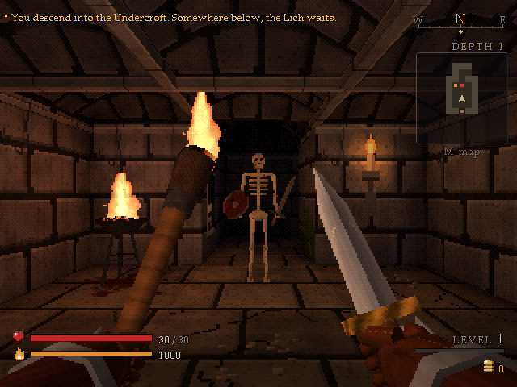
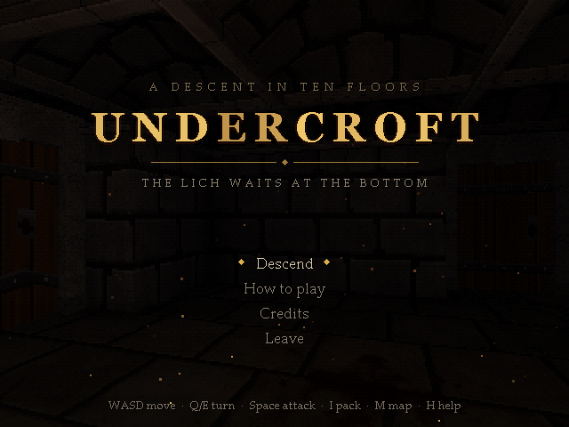
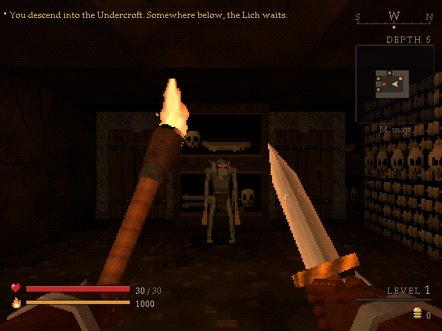
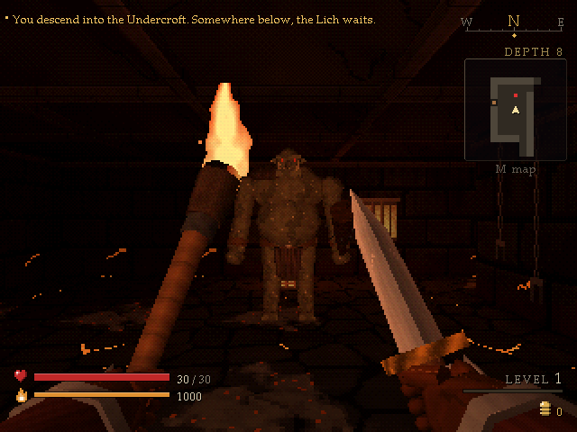
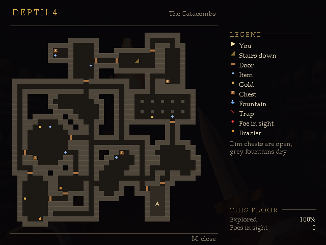

# Undercroft

A first-person dungeon crawler roguelike in the style of a PlayStation 1 game, written in C++ with
no engine and no libraries. Ten floors down, the Lich waits.



Every run is a new dungeon. You step square by square and turn by quarter turns; nothing moves until
you do. Your torch burns down with every step, the potions and scrolls are unlabelled until you try
them, and death is permanent.

| | |
|---|---|
|  |  |
|  |  |

## What's in it

- **Ten procedural floors** in three regions: the crypt, the bone-lined catacombs and the ember
  halls. Rooms, caves, pillared halls, locked-away vaults behind secret doors, traps, chests (some of
  them hungry) and fountains.
- **Fourteen monsters**, each with its own behaviour, animations and voice: rats and bats, skeletons
  that collapse into bones, a grave ooze, spiders, cultists that cast from a distance, wraiths that
  drain your light, gargoyles that wait as statues, mimics, ogres, imps, and the Lich at the bottom.
- **Weapons, armour, rings, wands, potions and scrolls**, identified by using them.
- **PS1 rendering**: a 320x240 frame with wobbling vertex snapping, warping (affine) textures,
  per-vertex lighting, fog and dithered 15-bit colour. Every texture and model is generated in code.
- **Sound**: creature voices and foley from CC0 recordings, plus a synthesised score for the title
  and the Lich, played on sampled instruments by a small sequencer the way PS1 music was.

## Controls

| Key | Action |
|---|---|
| W / S | step forward / back |
| A / D | sidestep |
| Q / E or arrows | turn |
| Space or F | attack the square ahead (walking into a monster attacks too) |
| Z or . | wait a turn, which also searches for traps and secret doors |
| R | rest until healed |
| Enter | take the stairs down |
| I or Tab | pack |
| M | map |
| H or F1 | help |
| F11 | fullscreen |

Bump into a chest to open it and into a fountain to drink.

## Playing it

**In a browser:** serve the `web` folder over http (opening `index.html` straight from disk won't
work), for example `python -m http.server --directory web`, then open the address it prints.

**On Windows:** build it (below) and run `undercroft.exe`. Keep the `sounds` folder next to the exe.

## Building

Windows, with [MSYS2](https://www.msys2.org/)'s UCRT64 g++:

```
build.bat
```

That makes `undercroft.exe` and `sim.exe`, a bot that plays hundreds of runs to check the balance.

The browser version uses MSYS2's Emscripten package (`pacman -S mingw-w64-ucrt-x86_64-emscripten`):

```
powershell -File build_web.ps1
```

[NOTES.md](NOTES.md) covers the architecture, the screenshot harness and everything else needed to
work on the code.

## Credits

Sound effects by Kenney, artisticdude and rubberduck, and the exploration music by yd, all released
under CC0. See [sounds/CREDITS.md](sounds/CREDITS.md). Everything else is generated by the game's
own code.

## Licence

The code is MIT licensed (see [LICENSE](LICENSE)). The recorded sounds are CC0.
